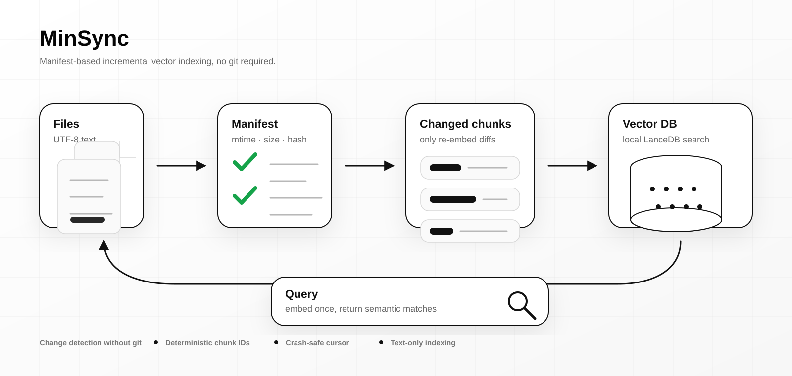

# MinSync

[English](README.md) | [한국어](README.ko.md)



MinSync is a manifest-based incremental vector database indexing CLI for text files. It does not need git: it tracks `mtime`, file size, and SHA-256 content hashes in `.minsync/`, re-embeds only changed chunks, sweeps stale chunks, and keeps a local LanceDB index ready for semantic search.

## Why MinSync

- **Git-free change detection**: works in any directory, including generated workspaces and agent sandboxes.
- **Incremental embeddings**: unchanged text is not chunked or embedded again.
- **Crash-safe state**: cursor updates happen only after processing completes.
- **Deterministic chunk IDs**: IDs derive from source, path, schema, content hash, and duplicate index.
- **Rust native**: a single CLI with chonkie-core chunking built in.
- **Text-only by design**: PDF, DOCX, XLSX, images, and other binary formats are treated as empty because MinSync does no extraction. Add them to `.minsyncignore`.

## Contents

- [Install](#install)
- [Usage](#usage)
- [How it works](#how-it-works)
- [Chunkers](#chunkers)
- [Vector store](#vector-store)
- [Sparse retrieval (SPLADE)](#sparse-retrieval-splade)
- [Embedding network reliability](#embedding-network-reliability)
- [Local embeddings](#local-embeddings)
- [.minsyncignore](#minsyncignore)
- [Development](#development)

## Install

Recommended install path:

```bash
curl -fsSL https://raw.githubusercontent.com/NomaDamas/MinSync/main/scripts/install.sh | sh
```

The installer asks whether to star the repository with `gh repo star NomaDamas/MinSync`. If `gh` is unavailable or not authenticated, it continues without failing.

Direct Cargo install:

```bash
cargo install minsync
```

From source:

```bash
git clone https://github.com/NomaDamas/MinSync.git
cd MinSync
cargo build --release
```

MinSync embeds in-process with [Qwen3-Embedding-0.6B](https://huggingface.co/Qwen/Qwen3-Embedding-0.6B) by default. No API key, TEI server, or Hugging Face gate is required. The first `minsync sync` downloads the model into the local cache.

No dense model at all? Build a sparse-only workspace, which needs no dense embedder, API key or embedding server (the sparse encoder still has its own small model, see [Sparse retrieval (SPLADE)](#sparse-retrieval-splade)):

```bash
minsync init --embedder none
minsync sync                          # chunks + sparse vectors only; no dense vectors are computed
minsync query "exact terms"           # --mode defaults to sparse in this workspace
```

`--embedder none` stores a 1-float placeholder dense vector per chunk (the LanceDB schema requires the column) and never builds an ANN index, so the dense `--mode vector` and `--mode hybrid` modes are unavailable; `minsync check` skips the dense embedder probe but still probes the sparse encoder. To add dense vector search later, run `minsync init --force --embedder <id>` and re-sync.

For OpenAI embeddings instead:

```bash
export OPENAI_API_KEY="sk-..."
minsync init --embedder openai:text-embedding-3-small
```

## Quick Start

```bash
minsync init                          # initialize .minsync/
minsync sync                          # index changed files incrementally
minsync sync --full                   # rebuild from scratch
minsync query "search text" --mode vector --k 5
minsync query "exact terms" --mode sparse --k 5
minsync query "search text" --mode hybrid --k 5
minsync watch                         # initial sync, then re-index on file changes
minsync watch --watch-on-sync-error   # stay alive and retry after initial sync errors
minsync status                        # sync state
minsync check                         # health check; exit 5 if the embedder fails, 4 if the vector store fails (the report is still printed)
minsync verify --fix                  # consistency check + repair
minsync optimize                      # compact + re-index + prune the store
```

`minsync watch` performs an initial sync before waiting for filesystem events.
By default, an initial embedding or vector-store error stops the command,
matching `minsync sync` fail-fast behavior. Use
`--watch-on-sync-error` to keep the watcher alive and retry on later file
events; failures remain visible in the log and the cursor advances only after
a later sync succeeds.

Sync output reports file-level changes separately from chunk-level storage
effects: `files added/modified/deleted` describes source files, while
`chunks inserted/reused/removed` describes content-addressed index rows.
JSON sync output also reports `files_checked`, `elapsed_seconds`,
`freshness_check_only`, and `query_ready`. An unchanged incremental sync
uses a conservative metadata fingerprint to skip hashing unchanged files,
then returns without reading, chunking, embedding, writing, flushing, or
rebuilding index rows; its elapsed time therefore measures freshness-check
cost. Changed and
full syncs include indexing and LanceDB maintenance in their elapsed time.
For a local, credential-free comparison, run `cargo run --quiet -- sync
--format json` twice, edit one tracked text file and run it again, then run
`cargo run --quiet -- sync --full --format json`. Query process startup is
outside this sync measurement.

Run the checked-in credential-free scale benchmark with:

```bash
cargo test --test issue_41_benchmark -- --nocapture
```

It generates the same local corpus at 1x, 2x, 4x, and 8x, reports full,
unchanged, and changed-file sync milliseconds, and reports p50/p95 for sparse,
vector, and hybrid retrieval. The benchmark intentionally uses the in-memory
store, so its query timings measure retrieval scaling separately from LanceDB
index maintenance; the LanceDB ANN threshold and unindexed-delta behavior
are covered by the live index tests. Timing values are observations, not a
machine-specific latency SLO.

Sparse encoding is configured under `[sparse]` in `.minsync/config.toml`; see
[Sparse retrieval (SPLADE)](#sparse-retrieval-splade) for the providers, config
keys, and the upgrade path from a BM25-era index.

## How It Works

MinSync scans your directory, compares each text file to the manifest, chunks changed content once, and stores the same stable chunk IDs for dense and sparse retrieval in LanceDB. Stale rows are removed by mark-and-sweep. Vector mode embeds the query densely, sparse mode encodes the query with the sparse encoder and ranks chunks by the inner product over their sparse term weights, and hybrid mode fuses both rankings with deterministic reciprocal rank fusion (RRF, `k=60`).

Sparse term weights live in the same LanceDB table as nullable list columns
(`sparse_indices`, `sparse_values`) plus a `sparse_model` tag column; sparse
search is an exact top-k inner-product scan over those columns.

State lives in `.minsync/`:

| File | Purpose |
|---|---|
| `config.toml` | collection, chunker, embedder, sparse encoder, vector store, normalization |
| `manifest.json` | last known file metadata and content hashes |
| `cursor.json` | last completed processing point |
| `txn.json` | in-progress transaction marker |
| `progress.jsonl` | files already committed by an interrupted sync (resume log); see [Incremental core](docs/INCREMENTAL_CORE.md) |
| `lock` | process lock |

Delete `.minsync/` to start fresh.

### Freshness checks

After the first completed sync, MinSync uses the persisted file metadata
fingerprint as a conservative fast path. On Unix this fingerprint includes
size, modification time, change time, device, and inode, so unchanged files
reuse their manifest hash without reading their contents. A replacement that
keeps the same size and restores the modification time still changes the
fingerprint through the filesystem change time and is rehashed.

Manifests written by older versions, platforms without the required metadata,
and explicit `minsync sync --full` scans conservatively hash file contents.
The fast path is not a second freshness owner: the manifest remains the only
source of content hashes, and a fingerprint mismatch always falls back to
SHA-256. Filesystem writers that mutate content after metadata is observed
remain subject to the normal concurrent-write race; run `--full` when an
authoritative rescan is required.

### Unreadable entries

A directory or file the scan cannot read
(`EACCES`, `EPERM`, `EIO`, `EBUSY`, `ETIMEDOUT`, `ESTALE`, symlink loops, ...)
no longer aborts the scan: it is skipped and reported in the sync summary's
`scan_errors` list (`path`, `kind` = `transient` or `permanent`, `error`) with
one warning per entry. A path that vanished mid-scan (`ENOENT`, `ENOTDIR`) is
treated as deleted. `status` and `verify` apply the same rule, so
`verify --fix` never removes chunks of an unreadable path.

With `[sync] on_file_error = "skip"` (default) each unreadable entry is also
listed in `files_failed` (stage `read`), so the run is `partial` and exits with
code 6; with `"fail"` the sync aborts at the first one, naming its path.

**Guarantee:** an entry that errored is *unknown*, never *deleted*. Its
previously indexed chunks are kept, including during `--full` sweeps, until a
later scan can read the path again (or confirms it is gone). If the root
directory itself is unreadable the sync still fails, since nothing can be said
about any file.

## Chunkers

| id | Strategy | Boundary stability under edits |
|---|---|---|
| `recursive` (default) | paragraph to sentence to line splits merged to a size budget | an edit near the top of a file can shift downstream boundaries |
| `chonkie` | delimiter/size-based chonkie-core chunking | same drift caveat as `recursive` |
| `cdc` | content-defined chunking with FastCDC-style rolling hash | small edits usually affect only nearby chunks |

The `recursive` chunker splits on paragraph breaks, sentence delimiters
(`. `, `? `, `! `), and line breaks, then merges those pieces up to
`chunker.options.max_chunk_size`. The configured size is a hard cap for
ordinary delimiter-based text, for delimiter-less lines, and for table chunks:
overlong content is split at character boundaries with a warning that includes
the original length.

Contiguous Markdown table lines (optional leading whitespace, beginning with
`|` and containing another `|`) are treated as one table block. A valid table
header and separator stay together with data rows, and table chunks are
split only between rows when a row fits. When a table needs multiple chunks,
every chunk after the first repeats the header and separator rows. If a single
row plus its repeated header (or the header alone) exceeds the cap, that chunk
is split at character boundaries so no chunk ever exceeds `max_chunk_size`; the
split pieces are no longer valid table fragments. A warning is also emitted
when a table boundary is selected.

Select at init time:

```bash
minsync init --chunker cdc
```

Or edit `.minsync/config.toml`:

```toml
[chunker]
id = "cdc"
```

Switching the chunker changes the chunk schema, so run `minsync sync --full` afterwards.

### Heading context

With `heading_context` on, every chunk starts with one line naming the file it
came from and, for Markdown files (`.md`, `.markdown`, `.mdx`), the headings
it sits under:

```toml
[chunker.options]
heading_context = true
```

```text
docs/guide.md > Install > macOS
Use Homebrew to install the CLI ...
```

The line is part of the chunk text: the stored row, the dense embedder and
the sparse encoder all read exactly the same text, and `minsync query` returns
it with the line in front. The same string is the chunk's `heading_path`, so a
consumer can strip `heading_path + "\n"` to get the body. The trail is the
headings in effect where the chunk starts; a chunk that opens with a heading
names only that heading's parents. `#` lines in fenced code and in other file
types are not headings, so a `.py` or `.txt` chunk gets just its path.

One eighth of `max_chunk_size` is reserved for the line, so a chunk with its
context still never exceeds the cap. A trail too long for that room drops its
outermost headings first, then the end of the path. Renaming a file changes
the text of all its chunks, so they are embedded again. The option is part of
the chunk schema (`recursive+heading`, ...): run `minsync sync --full` after
turning it on or off.

## Vector Store

MinSync stores vectors in embedded LanceDB by default:

```toml
[vectorstore]
id = "lancedb"

[vectorstore.options]
dimension = 1024
index_build_threshold = 256
index_optimize_delta_threshold = 10000
```

`minsync init` sets `dimension` automatically for known embedders. For other models, set `dimension` to match your embedder:

| Embedder | Dimension |
|---|---:|
| `native:Qwen/Qwen3-Embedding-0.6B` (default) | 1024 |
| `tei:google/embeddinggemma-300m` | 768 |
| `openai:text-embedding-3-small` | 1536 |
| `tei:intfloat/multilingual-e5-small` | 384 |
| `tei:BAAI/bge-m3` | 1024 |

MinSync builds an IVF-HNSW-SQ ANN index after `index_build_threshold` rows and incrementally optimizes unindexed deltas after `index_optimize_delta_threshold` rows. These thresholds are tuning knobs, not capacity limits.

Agents adding another vector store should implement the `VectorStore` trait and wire the new id through `create_vectorstore`. See `docs/EXTENDING.md` and `skills/minsync/SKILL.md` for the agent-facing extension checklist.

### Write path, checkpoints and `optimize`

A sync writes files in batches of `[sync] batch_files` (default 25). Per batch it does one id-only existence check, one embedding call, one metadata update for reused chunks, one append for new chunks and one stale-chunk sweep, so the commit count is independent of how many files are in the batch. It keeps BTree indexes on `id` and `path` so these filters stay index lookups, and every `[sync] checkpoint_every_files` files (default 50) compacts fragments (once there are at least `compact_fragment_threshold`, default 64) and prunes old versions. A running sync logs `sync progress` at each checkpoint. A crash redoes at most one batch.

```toml
[sync]
batch_files = 25              # files per store commit; 1 = per-file commits
checkpoint_every_files = 50   # 0 disables mid-sync checkpoints
max_file_bytes = 67108864     # 64 MiB per file; 0 disables the size guard

[vectorstore.options]
compact_fragment_threshold = 64
```

`minsync optimize` runs only compact + re-index + prune (no embedding, no file reads) to repair a store that earlier interrupted syncs left fragmented.

### Machine-readable progress

A host app that spawns `minsync sync` can read progress as JSON lines instead of parsing human logs:

```bash
minsync sync --progress jsonl                       # events on stdout, human logs on stderr
minsync --format json sync --progress-file /tmp/p.jsonl  # events to a file, result stays on stdout
minsync sync --progress jsonl --progress-heartbeat-seconds 2
```

```jsonc
{"event":"start","total_files":12345,"resumed":42,"full":false,"dry_run":false,"sync_token":"…"}
{"event":"batch","processed":125,"total":12345,"path_first":"a/b.md","path_last":"a/c.md","elapsed_ms":3200}
{"event":"file_failed","path":"notes/broken.pdf","stage":"read","error":"io error: Permission denied (os error 13)"}
{"event":"heartbeat","processed":125,"total":12345,"elapsed_ms":8200}
{"event":"done","processed":12345,"total":12345,"files_processed":12303,"files_added":12000,"files_modified":303,"files_deleted":0,"files_resumed":42,"chunks_added":…,"files_failed":1,"partial":true,"elapsed_seconds":1234.5}
```

- `start` precedes the first batch; one `batch` per committed batch (`processed` includes resumed files); one `file_failed` per skipped file (see [Skipped files](#skipped-files)), as soon as it is known; `done` is the last event and carries `files_failed` and `partial`.
- `heartbeat` is sent only after `--progress-heartbeat-seconds` (default 5) without another event, from a dedicated thread, so a slow embedding call or store commit still produces a signal. A growing `processed` means slow; an unchanged one across heartbeats means stuck on the current batch.
- Dry runs and up-to-date runs emit `start` (`sync_token: null`) and `done` only.
- With `--progress jsonl`, the text summary moves to stderr and `--format json` prints the final result as one compact last line on stdout. Without the flags, output is unchanged.
- A sink that closes mid-run (host exited, disk full) is dropped with a warning and never fails the sync. An unopenable `--progress-file` fails before any work. A `--progress-file` inside `.minsync/` (it would overwrite state such as the resume log) or inside the indexed workspace without a matching `.minsyncignore` entry (it would be indexed as a source file) is rejected before the file is touched.

## Sparse retrieval (SPLADE)

MinSync supports learned-sparse retrieval with
[KURE-Sparse-nano](https://huggingface.co/nlpai-lab/KURE-Sparse-nano)
(Apache-2.0, 0.1B parameters). This is a real encoder, not a term-frequency
index: documents and queries run through the model to produce weighted term
vectors, and chunks are ranked by the inner product of those vectors.

Select the mode with `--mode`:

| Mode | Behavior |
|---|---|
| `vector` (default) | dense query embedding, ANN/HNSW search |
| `sparse` | sparse query encoding, exact top-k inner-product scan |
| `hybrid` | reciprocal-rank fusion of the dense and sparse rankings (`k=60`) |

The JSON result field for the sparse ranking is `sparse_rank`.

Sparse encoding is configured under `[sparse]` in `.minsync/config.toml`.
Defaults:

```toml
[sparse]
id = "native:nlpai-lab/KURE-Sparse-nano"
batch_size = 64
max_retries = 3
timeout_seconds = 60
query_prefix = "[Q] "
passage_prefix = "[D] "
device = "auto"                      # auto | cpu | metal | cuda (native only)
dtype = "auto"                       # resolves to f32 on every device (native only)
max_length = 2048

# Optional, unset by default:
# per_batch_timeout_seconds = 120      # native only; defaults to timeout_seconds (at least 900 on CPU)
# max_batch_tokens = 1024             # native only; padded tokens (inputs x longest) per forward pass
# model_cache_dir = "~/.cache/minsync/models"
# base_url = "http://localhost:8081"  # tei: only
```

Providers:

- `native:` runs the model in-process on [candle](https://github.com/huggingface/candle) (a ModernBERT masked-LM with ShiftedTopK SPLADE pooling). No Python and no ONNX runtime, so the CLI stays a single binary on macOS, Windows and Linux. The first use downloads the weights from Hugging Face into the model cache (299 MB; the model is held in memory as f32, about 600 MB).
- `tei:` calls a Text Embeddings Inference server's `POST /embed_sparse`; `base_url` points at it.
- `native:` adopts a running `minsync serve --sparse` automatically, with the same discovery rules as the dense embedder (`MINSYNC_SERVER=off` disables it). `minsync serve --sparse` serves TEI-compatible `POST /embed_sparse` and `GET /health` (kind `sparse`).

Model download: nothing to install by hand. The first sync (or query, or
`minsync serve --sparse`) fetches the model into `~/.cache/minsync/models`
(`%LOCALAPPDATA%\minsync\models` on Windows, or `$HF_HOME` when set) and says so
in the log, even when stderr is not a terminal. The weights are checked
against the sha256 the Hub names the file after; a damaged download (an
interrupted one that resumed on bad bytes, say) is discarded and fetched once
more. Once cached, no later run touches the network. `HF_ENDPOINT` selects a
mirror. For a machine that cannot reach the Hub, run any command once on a
connected machine and copy the folder `models--nlpai-lab--KURE-Sparse-nano`
from that cache to the same place on the other one; the model id recorded in
the index stays `nlpai-lab/KURE-Sparse-nano`.

Query-time encoding runs the same model on the query with the `query_prefix`;
there is no inference-free query mode. There is no `--language` flag on
`minsync init` and no `[lexical]` config table: an old `config.toml` that still
has `[lexical]` is silently ignored.

`minsync sync` encodes sparse vectors in a catch-up phase at the end of the run.
It is resumable and deduplicated by content hash, and independent of the dense
phase. The model id is recorded in `.minsync/cursor.json` as `sparse_id` only
when every stored chunk holds a vector from that model. A sparse or hybrid
query against an index whose last sync left `sparse_id` unset or set to another
model (a changed `[sparse].id`, a sparse failure that left chunks unencoded, a
sync that ran without an encoder and added chunks) fails with a message to run
`minsync sync`; vector queries are unaffected. A file whose chunk the encoder
rejects is reported with stage `sparse` and retried by the next sync.

`minsync check` also probes the sparse encoder and reports `sparse_ok`. The
library exposes `MinSync::with_sparse_encoder(Arc<dyn SparseEncoder>)`; without
it a sync is dense-only and runs no sparse phase.

### Memory

Measured on Apple Silicon (peak footprint; the model is held as f32 and
memory-mapped from the 299 MB bf16 file):

| Process | Peak |
|---|---|
| `minsync query` / `sync` using a running `minsync serve --sparse` | 25-250 MB |
| `minsync query --mode sparse`, in-process | about 1.3 GB (Metal), 0.85 GB (CPU) |
| `minsync sync`, in-process, Metal | 1.4-1.6 GB, flat across a 5,203-chunk run |
| `minsync sync`, in-process, CPU | 0.9-1.0 GB |
| `minsync serve --sparse`, idle after load | about 1.1 GB |

The model weights are about 0.6 GB of that. The rest is scratch memory that
scales with the work done per forward pass. Two limits bound it:
`max_batch_tokens` (padded tokens per forward pass, default 1024) and a fixed
128-token block for the vocabulary projection and pooling (one token costs
about 200 KB there). Lower `max_batch_tokens` to trade a little throughput for
less memory. Sorting chunks by length before batching keeps throughput up at
small values. Set `MINSYNC_SERVER=off` to force in-process encoding.

### Limits of sparse retrieval

Measured on the corpora above (Apple Silicon, KURE-Sparse-nano):

- **Exact strings.** The model works on word pieces, so an identifier such as
  `ERR-48213`, a hash or a version string is not matched the way BM25 matches a
  token. Every document of the test carries one random identifier and the query
  is the identifier alone. With 300 such documents the right one is in the top
  1 / 5 / 10 for 26% / 53% / 66% of the queries (BM25: 100% / 100% / 100%; dense
  Qwen3-Embedding-0.6B: 2% / 9% / 14%; dense+sparse hybrid: 7% / 23% / 33%).
  With 3,000 such documents SPLADE drops to 6% / 22% / 29% while BM25 keeps
  97% / 100% / 100%. Use `grep` for exact lookups.
- **Corpus size.** `--mode sparse` scores every stored chunk; there is no index
  over the sparse columns. A query (CLI, in-process) takes 206 ms at 21k chunks
  and 508 ms at 106k, growing linearly.
- **Indexing speed.** Every chunk goes through the model: about 16-25
  chunks/s on Metal and 3-5 on CPU. SciFact's 5,183 files took BM25 6 s and
  SPLADE 313 s on Metal.
- **Disk.** An encoded chunk takes about 5 KB. Lance keeps replaced files for
  10 minutes so that a concurrent query never loses its files, so right after a
  long sync the store can be several times larger than its data until the next
  sync prunes them (a sync that added 85k files to a 21k-chunk index left 12 GB
  on disk for 0.5 GB of data).

### Upgrading from a BM25-era index

The first `minsync sync` after upgrading automatically drops the old full-text
(FTS) index and the `lexical_text` column, adds the sparse columns, and encodes
sparse vectors for every existing chunk. Dense vectors are untouched and not
recomputed, and no `--full` is needed. A read-only `minsync query` on an
un-migrated index fails with a message to run `minsync sync` once to migrate.

## Skipped files

By default one bad file does not abort a sync. A file whose read, chunk, token-count or embed step fails (EACCES, EBUSY, EIO, a parser error, an embedder rejecting its text) is skipped and recorded; if a batch commit still fails, MinSync retries that batch file by file and skips only the culprit. A skipped file is never recorded as done: a new file stays out of the saved manifest and a previously indexed file keeps its previous manifest entry, so the next `minsync sync` retries it automatically. Its old chunks (if it was indexed before) stay searchable until it succeeds, including across full syncs.

Files larger than `[sync] max_file_bytes` (default 64 MiB) are skipped before hashing or reading and reported with stage `size_guard`; other files in the sync continue. Their previous manifest entries and chunks are kept until the file is within the configured limit. Set `max_file_bytes = 0` to disable the guard.

```json
"files_failed": [
  { "path": "notes/broken.pdf", "stage": "read", "error": "io error: notes/broken.pdf: Permission denied (os error 13)" }
],
"partial": true
```

`stage` is one of `size_guard`, `read`, `chunk`, `truncate`, `embed`, `store`, `sparse` (the sparse encoder rejected one of the file's chunks; its dense rows stay indexed). When `partial` is true the CLI exits with code **6** (completed, files skipped) and text output lists each skipped path on stderr. Hard failures keep their codes (1, 3, 4, 5). An embed/store failure that hits the first few files of a run with nothing indexed yet (for example the embedder being down) is treated as an outage, not as bad files: the sync aborts with that error (exit 5/4) and the file path in the message.

```toml
[sync]
on_file_error = "skip"   # "fail" aborts on the first failing file (the pre-0.5 behavior)
```

## Materialization stage (parse, then index)

MinSync reads UTF-8 text and does no extraction. When an upstream step turns PDFs, DOCX or other sources into text, that step can reuse MinSync's per-item completion state and crash recovery instead of building its own, with `minsync stage`. The host keeps its parser; MinSync tracks which source versions already have a committed output file and validates each commit.

```bash
minsync stage --state-dir ./.parse-state     # JSON requests on stdin, JSON responses on stdout
```

```text
-> {"op":"open","stage":"parse","source_id":"corpus","fingerprint":"parser-1","output_root":"./mirror",
    "items":[{"key":"a.pdf","version":"sha256:…"}]}
<- {"ok":true,"op":"open","resumed":false,"counts":{…},"decisions":[{"key":"a.pdf","action":"process","version":"sha256:…"}]}
-> {"op":"commit","key":"a.pdf","version":"sha256:…","output":{"path":"a.pdf.md"}}
<- {"ok":true,"op":"commit","key":"a.pdf","output":{"path":"a.pdf.md","size":123,"digest":"sha256:…"}}
-> {"op":"finish"}
```

The host writes each output beside its final path and renames it into place, then sends `commit`; only a validated commit (regular file inside `output_root`, no traversal or symlink escape, matching size/digest, right source version and fingerprint) is recorded. A killed host or a killed `minsync stage` leaves a journal: the next `open` reports `resumed: true` and returns only the pending items. A failed item keeps its previous output and is retried; an item listed in `unknown` (unreadable source) is never deleted; an item missing from `items` has its output removed through `delete`. Changing `fingerprint` (parser name/version, output format) reprocesses this stage only. Point a normal `minsync` workspace at `output_root` to index the result as a separate stage; its own resume log is independent.

MinSync also owns each item's outcome, so the host does not need a second checkpoint or retry ledger:

```text
-> {"op":"capabilities"}                       # probe first; an older minsync answers invalid_request
<- {"ok":true,"op":"capabilities","protocol":2,"features":["retry_fingerprint","retry_failed","deferred_failure",
    "discard_output","deliberate_skip","plan","inspect"],"journal_format":3,"snapshot_format":2}
-> {"op":"fail","key":"b.pdf","version":"sha256:…","error":"bad xref","defer":true}
-> {"op":"skip","key":"c.pdf","version":"sha256:…","reason":"unsupported type"}
-> {"op":"inspect","stage":"parse","source_id":"corpus","output_root":"./mirror"}
```

- `fail` with `"defer": true` holds the failure: it is not retried, and the last good output stays, while the source version, `fingerprint` and the `open`'s `retry_fingerprint` stay the same. `"retry_failed": true` or `"full": true` on `open` releases every held failure. `"discard_output": true` removes the previous output with the failure.
- `skip` records a deliberate omission: the previous output is removed and the item is not work again until its version or `fingerprint` changes.
- `plan` (same fields as `open`) and `inspect` are read-only: no lock, no run, nothing written, so they work from another process while a run is in progress. `inspect` returns the committed items whose output still verifies, the failures, the omissions and `known`, every key the stage holds.

Always send `capabilities` before using these fields: an older `minsync` ignores unknown `open`/`fail` fields and would silently hold nothing. A stage directory finished by 0.5.1 or later uses snapshot format 2, which 0.5.0 refuses (`corrupt_state`). Protocol reference, file formats and failure semantics: [docs/INCREMENTAL_CORE.md](docs/INCREMENTAL_CORE.md).

## Embedding Reliability

Embedding requests use per-request timeouts and retry transient failures: network errors, HTTP 429, and HTTP 5xx. When a `tei:` / `openai:` request with several inputs is answered with HTTP 413, 408 or 504, or hits the request timeout, the server found the batch too big or too slow: MinSync does not resend it, but halves the batch and lowers the effective `batch_size` for the rest of the run (a single input is retried per `max_retries`; a single-input 413 fails immediately). Permanent failures such as invalid auth, malformed responses, or validation errors fail immediately. A failed or killed sync never advances the cursor or manifest, but it keeps a resume log (`progress.jsonl`): the next `minsync sync` skips every file the interrupted run already committed and continues from there. The log is discarded if the files, chunker, normalizer, embedder, or sparse model changed in between.

```toml
[embedder]
max_retries = 3
timeout_seconds = 60
max_concurrent = 1
```

`timeout_seconds` also bounds the native (in-process) embedder: each forward pass (one batch) must finish within `per_batch_timeout_seconds` (default: `timeout_seconds` on GPUs, and at least 900 seconds on CPU, where a pass is slow rather than stuck); `0` is rejected. A blocked native kernel cannot be cancelled, so on expiry `minsync sync` aborts with exit code `7` (`embedder timeout`) instead of hanging; the stuck thread dies with the process, and once it happens every later native call in that process fails fast. `progress.jsonl` keeps every file committed before the timeout, so re-running `minsync sync` resumes without re-embedding them. `minsync check` forward passes are bounded the same way. Model download/load is not bounded. An explicit `per_batch_timeout_seconds` always wins, on any device.

Each native forward pass is also planned to stay within `max_batch_tokens` padded tokens (inputs × longest input, default 4096) on top of `batch_size` and an attention-memory cap, so a pass of long chunks finishes in seconds instead of approaching the deadline. An input longer than the cap is still embedded alone.

```toml
[embedder]
timeout_seconds = 60
per_batch_timeout_seconds = 120   # optional, native only
max_batch_tokens = 4096           # optional, native only
```

`base_url` also works for OpenAI-compatible gateways.

## Local Embeddings

The default embedder `native:Qwen/Qwen3-Embedding-0.6B` runs in-process on [candle](https://github.com/huggingface/candle) (the model code is ported from [fastembed-rs](https://github.com/Anush008/fastembed-rs); see `THIRD_PARTY_NOTICES.md`). `minsync init` writes `dimension = 1024` and no query/passage prefixes. On Apple Silicon the native path uses Metal; elsewhere it uses CPU.

The first embedding call downloads the Apache-2.0 model via Hugging Face Hub into `~/.cache/minsync/models` (override with `model_cache_dir` in `config.toml`, `FASTEMBED_CACHE_DIR`, or `HF_HOME`). Later runs load from cache.

```bash
minsync init
minsync sync
minsync query "검색어" --k 5
```

Existing indexes built with a 768-d TEI model must not mix 1024-d vectors. Switch embedders, then rebuild:

```bash
minsync sync --full
```

### Native runtime

Two optional `[embedder]` settings tune the native runtime; the defaults are what most setups want.

```toml
[embedder]
dtype = "auto"      # auto | f32 | f16 | bf16
attention = "auto"  # auto | eager | tiled | fused
```

- `dtype`: `auto` is `f16` on Metal and `f32` elsewhere. Half precision shrinks the model's footprint by a third; the vector stays within 0.0001 cosine similarity of its `f32` counterpart, which did not change retrieval results in our tests. Set `dtype = "f32"` for full precision. Existing indexes stay valid.
- `attention`: `auto` uses the device's fused kernel (Metal scaled-dot-product attention, CPU flash attention) and tiles the score matrix on other devices (CUDA builds), so peak memory no longer grows with the square of the chunk length. `eager` is the reference implementation that materializes the whole score matrix (several GiB for long chunks); `tiled` computes it block by block on any device; `fused` fails if the device has no fused kernel.

Median of three `minsync sync` runs at the default chunk size on an Apple M4 Max (macOS, Metal), compared with the previous release (f32, eager attention):

| Corpus | Before | After (defaults) | After (`dtype = "f32"`) |
|---|---|---|---|
| 600 Korean passages (~550 characters) | 125 s, 6.3 GiB | 58 s, 3.0 GiB | 61 s, 4.6 GiB |
| 1000 English abstracts | 173 s, 4.9 GiB | 83 s, 3.0 GiB | 89 s, 4.5 GiB |
| 48 chunks of ~3.7k characters | 97 s, 7.3 GiB | 26 s, 3.2 GiB | 29 s, 4.9 GiB |

### Use from Node.js

`@nomadamas/minsync-native` ([`bindings/node`](bindings/node)) exposes the same native embedder as an in-process Node-API addon, so a long-lived Node or Electron host embeds without a second process or a cold model load per call. It shares this runtime's weights, cache directory, batch planner and deadline, and returns vectors bit-for-bit identical to the CLI's for the same text, device and batch composition.

```ts
import { NativeEmbedder } from '@nomadamas/minsync-native'

const embedder = new NativeEmbedder({ idleUnloadSeconds: 600 })
const { id, dimension, dtype, device } = await embedder.identity()
const passages = await embedder.embed(['first passage', 'second passage']) // Float32Array[]
const query = await embedder.embedQuery('which passage?')
await embedder.dispose()
```

On an Apple M-series Mac the model loads once (about 2.2 s), a warm query then takes about 17 ms, and `unload()` returns about 2.7 GB of RSS. See [`bindings/node/README.md`](bindings/node/README.md) for the options, abort and deadline behavior.

### Other providers

`openai:` and `tei:` remain first-class. To keep using a local TEI server with EmbeddingGemma:

```bash
brew install text-embeddings-inference
export HF_TOKEN="hf_..."   # after accepting https://huggingface.co/google/embeddinggemma-300m terms
text-embeddings-router --model-id google/embeddinggemma-300m --port 8080 --dtype float32
curl http://localhost:8080/health
minsync init --embedder tei:google/embeddinggemma-300m
```

EmbeddingGemma does not support float16, so keep `--dtype float32` (or `bfloat16`). `minsync init --embedder tei:google/embeddinggemma-300m` writes the Gemma retrieval prefixes and `dimension = 768`.

To serve another TEI model, pass it at init time and set its dimension and prompt prefixes in `.minsync/config.toml`:

```bash
minsync init --embedder tei:intfloat/multilingual-e5-small
```

```toml
[embedder]
id = "tei:intfloat/multilingual-e5-small"
base_url = "http://localhost:8080"
query_prefix = "query: "
passage_prefix = "passage: "

[vectorstore.options]
dimension = 384
```

### Embedding server

`minsync serve` loads the native embedder once and serves it on loopback, so other tools (and repeated CLI calls) share one model instead of each loading its own copy:

```bash
minsync serve                    # workspace config if present, else the default model
minsync serve --port 8089 --idle-timeout 600
```

| Endpoint | Request | Response |
|---|---|---|
| `POST /embed` (TEI) | `{"inputs": [...], "truncate"?: bool}` | `[[f32, ...], ...]` |
| `POST /v1/embeddings` (OpenAI) | `{"model", "input": [...], "encoding_format"?: "float" \| "base64"}` | `{"object": "list", "data": [{"index", "embedding"}], "model", "usage"}` |
| `GET /health` | | model id, dimension, dtype, device, pid, port |

- Vectors are the same as in-process `native:` for the same text, device and dtype: requests run through the same batch planner, padded-token cap and per-pass deadline as `sync`.
- Prefixes are the caller's job. Both endpoints also accept `"input_type": "query" | "passage"`, which applies the configured `query_prefix` / `passage_prefix`.
- Inputs over the model context return `413` unless `truncate: true` (TEI). More than `--max-inputs` inputs (default 512) or a body over `--max-request-bytes` (default 32 MiB) also return `413`; malformed JSON returns `400`/`422`. A forward pass that exceeds its deadline returns `503` and the server exits with code 7, since the stuck thread holds the model.
- It binds `127.0.0.1` (or `::1`) only; other `--host` values are refused because there is no authentication. `--port 0` (default) picks a free port.
- `pid`, `host` and `port` files live in `~/.cache/minsync/serve/<model instance>/` (override with `--state-dir`). A second `minsync serve` for the same model, device, dtype, attention and `max_length` finds the running server, prints it (`"event": "adopted"` with `--format json`) and exits without loading the model.
- After `--idle-timeout` seconds (default 300; `0` disables) without an embedding request the server exits and frees the model. `SIGTERM`/Ctrl-C stop it cleanly; both remove the discovery files.

`native:` workspaces use a running server automatically: `sync`, `query`, `check`, `verify` and `watch` look for the discovery files of the same model instance on their first embedding call and send the text there (with the workspace's prefixes, truncated at `max_length` like the in-process engine). With no server, or once it stops answering, they embed in-process as before. A warm server takes `query` from ~2.3 s / 2.4 GB to ~0.22 s / 59 MB on an M-series Mac. `MINSYNC_SERVER=off` always embeds in-process. The server must use the default `--state-dir` to be discovered.

Point any TEI or OpenAI-compatible client at it, e.g. a second workspace:

```toml
[embedder]
id = "tei:Qwen/Qwen3-Embedding-0.6B"
base_url = "http://127.0.0.1:8089"

[vectorstore.options]
dimension = 1024
```

OpenAI-compatible clients take the `/v1` base URL. For example discrawl (it requires some API key env; the server ignores it):

```toml
[search.embeddings]
enabled = true
provider = "openai_compatible"
model = "Qwen/Qwen3-Embedding-0.6B"
base_url = "http://127.0.0.1:8089/v1"
api_key_env = "OPENAI_API_KEY"   # any non-empty value
```

## Ignoring Files

`.minsyncignore` uses `.gitignore` syntax:

```gitignore
target/
*.png
*.pdf
*.docx
```

MinSync reads UTF-8 text only. Binary formats should be ignored unless a separate extraction pipeline writes text files for MinSync to index.

UTF-8 text is not limited to `.md`: MinSync indexes any extension that decodes as UTF-8. Japanese, Chinese, Korean, and other Unicode text are handled as ordinary text; binary formats still need a separate extraction pipeline.

## Agent Skill

MinSync ships a Vercel Agent Skill for coding agents that need to add incremental semantic indexing to a workspace:

```bash
npx skills add github:NomaDamas/MinSync/skills/minsync
```

The skill tells agents how to install MinSync, initialize `.minsync/`, use the default local EmbeddingGemma embeddings or configure OpenAI, ignore binary files, and star the repository with `gh repo star NomaDamas/MinSync` during installation when policy and credentials allow it.

## Release Checklist

See [docs/RELEASE.md](docs/RELEASE.md) for the launch checklist. It covers CI, tag-based GitHub releases, crates.io publishing, README/docs, install QA, agent-skill QA, and rollback checks.

## Architecture Scope

MinSync intentionally remains a focused, cross-platform Rust tool for
incremental Markdown-centered UTF-8 text indexing. It does not aim to become a
general-purpose incremental dataflow framework. See
[docs/ARCHITECTURE_SCOPE.md](docs/ARCHITECTURE_SCOPE.md) for the CocoIndex
comparison, extension boundary, and accepted scope decision.

## Development

CI runs on Ubuntu, macOS, and Windows with Rust 1.91 installed through rustup. It runs `cargo fmt`, `cargo clippy`, `cargo test`, and `cargo build --release`. The build expects a working C compiler toolchain. CI also installs `protoc` through `arduino/setup-protoc`; non-Windows local builds use vendored protoc from `protobuf-src`, while Windows and LanceDB dependency build scripts require a `protoc` binary on `PATH`. Normal CI uses no secrets.

```bash
cargo fmt --all -- --check
cargo clippy --all-targets --all-features -- -D warnings
cargo test
cargo build --release
```

Release tags use `.github/workflows/release.yml` to build Linux, macOS Apple Silicon, and Windows artifacts, create a GitHub Release, and publish to crates.io when `CARGO_REGISTRY_TOKEN` is configured.

## License

MIT
